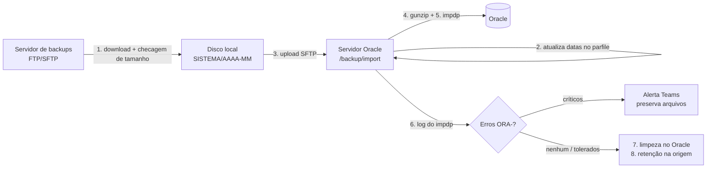

# Oracle Data Pump Automation

Automação em Python da rotina de **atualização de bases Oracle a partir de exports Data Pump**:
busca os dumps mais recentes de cada sistema num servidor de backups (FTP/SFTP), envia para o
servidor Oracle, ajusta os parfiles, roda o `impdp`, analisa o log em busca de erros `ORA-` e
faz a limpeza e a retenção, sistema por sistema, com um modo agendado que só processa o que mudou.

Substitui um procedimento manual (transferir arquivos, editar parfiles e rodar o `impdp` à mão)
por um comando idempotente, que pode ser reexecutado com segurança depois de qualquer falha.



## Destaques técnicos

- **Pipeline de 8 etapas por sistema**, com dry-run, modo teste e retomada a partir de qualquer sistema (`--from`).
- **Processamento arquivo a arquivo**: cada dump é enviado, descompactado, importado e apagado antes do próximo,
  então o disco do servidor Oracle só precisa comportar o maior arquivo, não a soma de todos.
- **Integridade de transferência**: download e upload conferem o tamanho remoto × local e tentam de novo
  (até 3×) — um arquivo truncado nunca passa por "presente".
- **Idempotência**: pula upload/gunzip se o arquivo já está no servidor com o tamanho certo; o parfile é
  atualizado "cirurgicamente" (só as datas e o sufixo de teste), sem duplicar parâmetros.
- **Análise de log do impdp** com lista de códigos tolerados global e por sistema, e suporte a tolerar só um
  trecho específico de mensagem (ex.: uma coluna), sem mascarar o mesmo código em outro lugar.
- **Modo agendado** (`agendado.py`): consulta tamanho e data de modificação na origem, compara com um banco de
  controle **SQLite** e só processa o que é novo; espera o arquivo "assentar" (30 min sem mudança) antes de pegar.
- **Lock com heartbeat**: impede execuções sobrepostas sem confundir uma importação longa e saudável com um
  lock abandonado por crash.
- **Notificações no Microsoft Teams** (Adaptive Card via webhook), sem nunca registrar a URL no log.
- **Segredos fora do código**: senhas e webhook vêm do `.env` ou de variáveis de ambiente.

## Estrutura

```
oracle-datapump-automation/
├── config/config.yaml        # configuração (hosts, diretórios, sistemas, erros tolerados) - sem segredos
├── .env.example              # modelo dos segredos (usuários, senhas, webhook)
├── main.py                   # execução manual (CLI ou menu interativo)
├── agendado.py               # verificação diária: processa só bases novas/alteradas
├── executar_automacao.bat    # launcher interativo para Windows
├── src/
│   ├── cli.py                # menu interativo + argparse
│   ├── config_loader.py      # leitura do YAML + injeção dos segredos do .env
│   ├── clients/              # I/O de rede
│   │   ├── backup_source.py  #   FTP/SFTP: listagem, download com retry, retenção
│   │   └── oracle_ssh.py     #   SSH/SFTP: upload, gunzip, impdp, df, limpeza de RMAN
│   ├── core/                 # regras do procedimento (sem I/O de rede direto)
│   │   ├── naming.py         #   convenção única de nomes de arquivo + modo teste
│   │   ├── parfile_manager.py#   atualização das datas e do sufixo nos .par
│   │   ├── log_analyzer.py   #   classificação dos erros ORA-/LRM-/UDI-
│   │   ├── control_db.py     #   estado e histórico das execuções (SQLite)
│   │   ├── lock.py           #   lock de execução com renovação
│   │   └── orchestrator.py   #   coordena as 8 etapas por sistema
│   └── support/              # log colorido, alertas e Teams
└── tests/                    # pytest (sem rede: tudo mockado)
```

## Instalação

```bash
python -m venv .venv
.venv\Scripts\pip install -r requirements.txt      # Windows
# source .venv/bin/activate && pip install -r requirements.txt   # Linux/macOS
cp .env.example .env                               # e preencha usuários/senhas
```

Ajuste `config/config.yaml` (hosts, diretórios e a lista de sistemas).

## Uso

```bash
python main.py                                 # menu interativo
python main.py --sistema VENDAS --dry-run      # simulação segura
python main.py --sistema VENDAS                # execução real de um sistema
python main.py --all                           # todos os sistemas
python main.py --all --from FINANCEIRO         # retoma a partir de um sistema
python main.py --sistema VENDAS --skip-origem  # usa dumps já baixados no disco local
python main.py --sistema VENDAS --teste        # valida o fluxo real com sufixo "_teste" nos arquivos
```

Execução agendada (ex.: Agendador de Tarefas, diariamente):

```bash
python agendado.py --seed               # mostra o estado atual da origem (não grava nada)
python agendado.py --seed --confirmar   # grava esse estado como ponto de partida
python agendado.py                      # verificação diária
```

O processo sai com código `1` em qualquer falha, para o agendador detectar.

## As 8 etapas

1. **Download**: agrupa os arquivos do sistema por data (`AAAAMMDD` no nome) e baixa só a data mais recente.
2. **Parfiles**: troca a data antiga pela nova em `dumpfile=`/`logfile=` e aplica/remove o sufixo de teste.
3. **Upload** dos `.dmp.gz` para o diretório de import do Oracle.
4. **Descompactação** remota (`gunzip`).
5. **Importação** com `impdp ... parfile=...`.
6. **Análise do log**: erros críticos interrompem o sistema e disparam alerta, **preservando** dump e log
   para reexecução; erros tolerados geram só um aviso de visibilidade.
7. **Limpeza** dos dumps e logs no Oracle (só se não houve erro crítico).
8. **Retenção** na origem: mantém as N datas de export mais recentes.

## Testes

```bash
pip install -r requirements.txt
python -m pytest
```

## Licença

[MIT](LICENSE)
